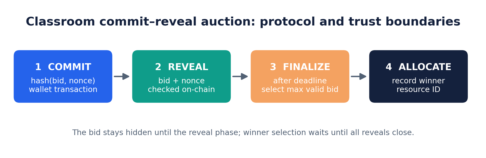
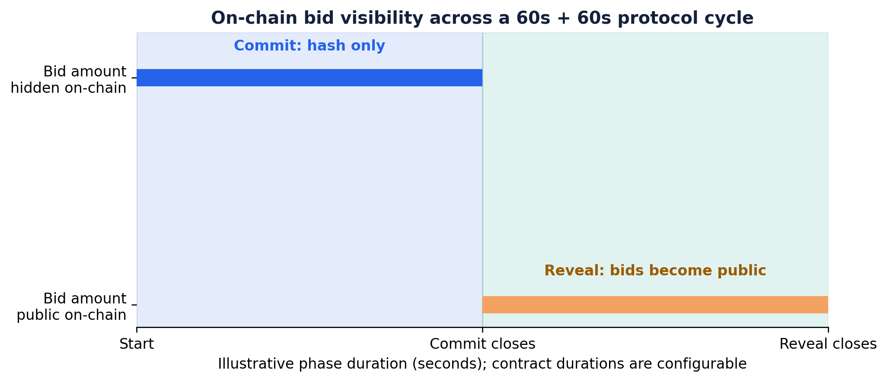
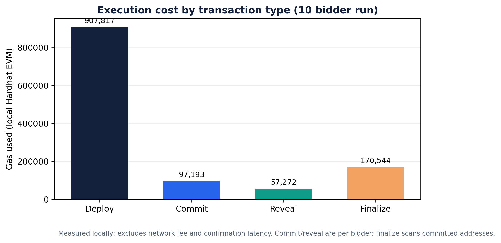
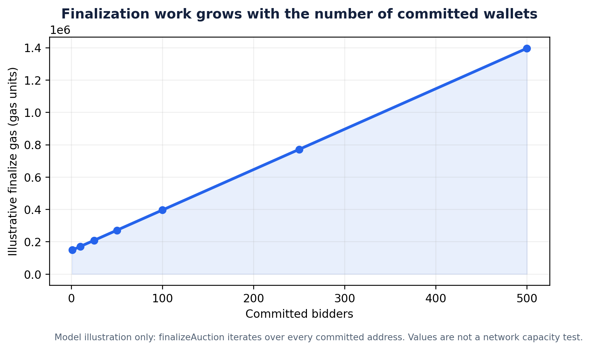
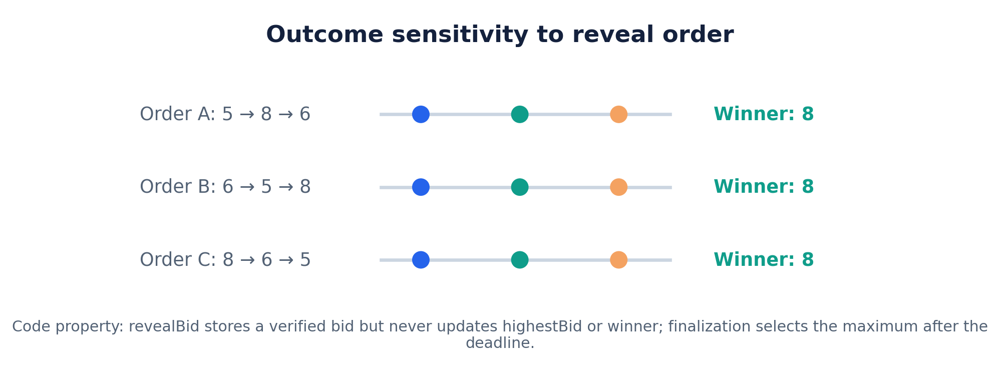
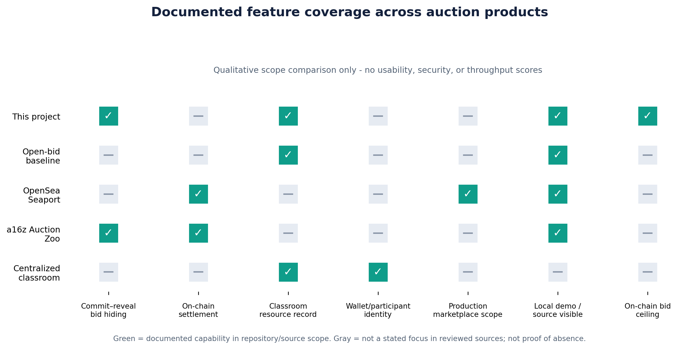
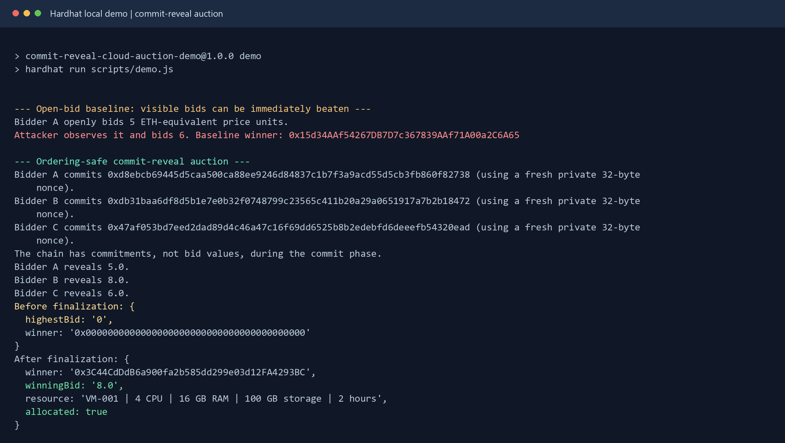
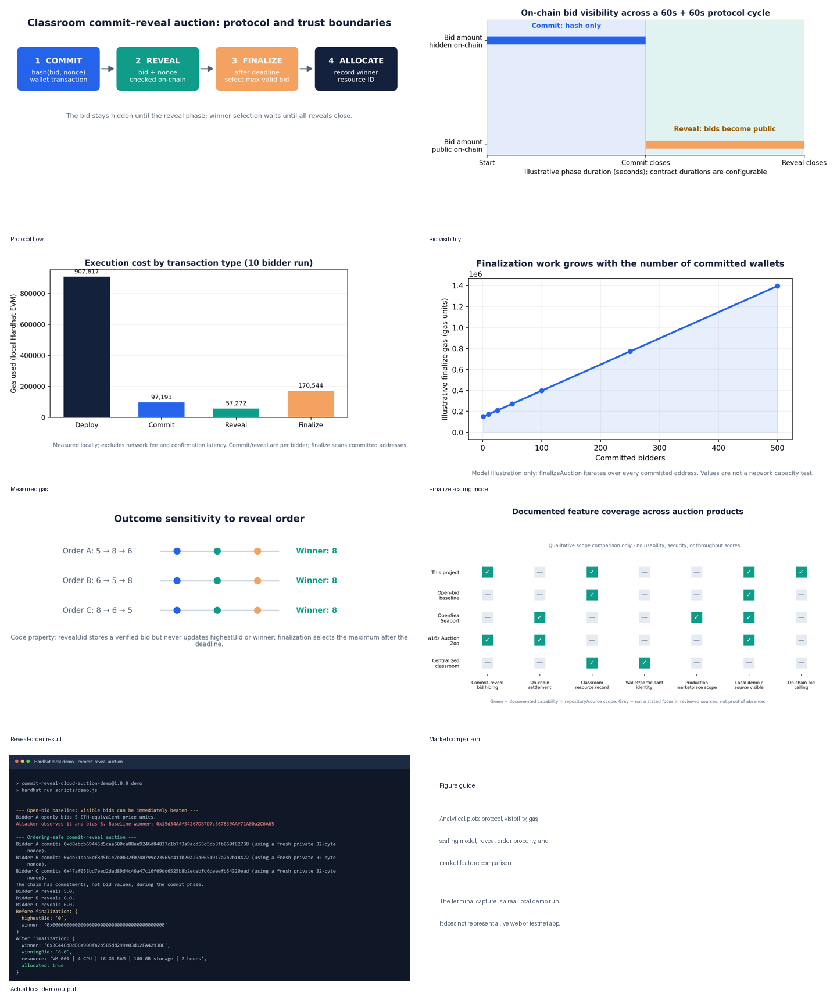

# Research Paper: A Commit–Reveal Auction for Classroom Cloud Resource Allocation

**Author:** Student project team  
**Version:** 1.0 (repository-based study)  
**Date:** 15 November 2026

## Abstract

This paper presents a classroom-scale demonstration of a sealed-bid commit–reveal auction for allocating a single time-bounded cloud resource. The implementation combines a Solidity contract, Hardhat development tooling, and a responsive browser interface with QR invite links, wallet connection, bid-secret recovery, phase status, activity, and organizer controls. Bidders submit a commitment hash during a commit interval, then reveal a bid and nonce during a reveal interval. The contract accepts a reveal only when its hash matches, delays authoritative winner selection until the reveal interval has ended, and records a winning bidder against a resource description. A configurable maximum bid is enforced on-chain at reveal. In a local EVM measurement with ten bidders, deployment used 907,817 gas, a commitment 97,193 gas, a reveal 57,272 gas, and finalization 170,544 gas. These are reproducible local execution measurements, not public-testnet throughput or latency results. The contribution is a compact teaching implementation that combines bid concealment during the commit phase, deterministic post-phase winner selection, a classroom bid ceiling, and an explicit open-bid baseline. The current build has not been deployed to Sepolia, does not verify one wallet per student, accept bids as payment, or provision a real cloud resource. We compare it with open auctions, marketplace protocols, and sealed-bid implementations, then describe the remaining path to a live testnet classroom trial.

**Keywords:** commit–reveal, sealed-bid auction, Ethereum, Solidity, classroom demonstration, cloud resource allocation, front-running

## 1. Introduction

Open auctions expose bids as transactions or state updates while an auction is running. A participant who sees a visible bid can respond with a higher one; transaction ordering can also affect inclusion and timing. A sealed-bid format reduces this information channel by separating the act of choosing a bid from the later act of revealing it. This project uses hash commitments so the contract can record that a participant committed without storing the bid amount in cleartext during the commit phase.

The motivating classroom problem is practical: demonstrate fairer allocation of a scarce shared resource, such as a short-lived virtual machine, while allowing a group to participate concurrently from their own devices. A blockchain ledger makes commitment and final results independently inspectable, while phase transitions impose common rules. The current resource is only an allocation record (`VM-001`, 4 CPU, 16 GB RAM, 100 GB storage, two hours); the software does not provision a VM or transfer funds.

This paper answers three questions: (1) what properties does this implementation provide compared with a naive open-bid baseline; (2) what transaction and computation costs are visible in a local EVM run; and (3) what remains necessary to turn a code demonstration into a classroom testnet product?

## 2. Related Work and Market Comparison

“Market comparison” spans different categories. The projects below are not interchangeable products: a marketplace protocol coordinates digital-asset orders, while this repository is a single-resource educational auction contract. Feature comparisons therefore describe documented design scope rather than claim a head-to-head performance result.

| System / category | Auction or order model | Bid visibility / settlement | Scope compared with this project |
|---|---|---|---|
| This project (`CloudAuction`) | Single-resource, first-price, highest valid revealed bid wins | Hash commitment, later public reveal; result recorded after deadline; no payment | Classroom browser UI, QR invite, wallet recovery, configurable bid ceiling; no human identity verification, custody, or provisioning |
| `OpenBidBaseline` (included control) | Simple highest-so-far bid | Amount and current winner are public immediately | Minimal pedagogical control; demonstrates reactive outbidding, not a production marketplace |
| OpenSea Seaport | General marketplace protocol for buying/selling NFTs through orders | Order/fulfillment protocol, not this project’s commit–reveal classroom flow | Much broader digital-asset marketplace interoperability; not a direct cloud-resource allocation comparator |
| a16z Auction Zoo | Reference implementations of several on-chain sealed-bid mechanisms, including Vickrey variants | Includes collateralized designs and distinct payment rules | Stronger auction-mechanism breadth and economic design; significantly more complex than this demo; archived in 2026 |
| Public sealed-bid tutorial implementations | Commit/reveal contracts with lifecycle, refund, or testnet examples | Varies by repository; commonly reveal values become public | Demonstrates that commit/reveal is established; this project’s differentiator is the classroom resource framing and paired open-bid teaching baseline, not invention of the protocol |
| Centralized classroom auction | Server-managed account/session bidding | Depends on operator; may be hidden or public | Lower wallet friction and easier identity management; requires trust in the service operator and database |

The comparison supports a restrained novelty claim. Commit–reveal itself is a well-known mechanism. The useful project contribution is its integration into a small, explainable resource-allocation exercise with an explicit phase model, a maximum-bid rule, and a baseline contract that lets learners compare observable outcomes. It is not evidence of a new cryptographic primitive or a superior commercial marketplace.

### 2.1 Comparative interpretation

The comparison separates auction privacy, settlement, identity, and product integration. The included open-bid control demonstrates immediate public leader updates. `CloudAuction` changes that information flow but does not implement payment. Seaport addresses interoperable marketplace orders and fulfillment for digital assets. The Auction Zoo explores multiple auction mechanisms and payment rules, including sealed-bid designs, which makes it a research reference rather than a classroom product. A centralized classroom auction can handle registration and account recovery more easily, but its operator controls the database and audit trail.

Figure 6 visualizes these documented feature differences. Its binary markers mean only that a capability is present in the cited/documented scope; they do not measure quality, security, throughput, ease of use, or production readiness. Blank cells mean the feature is not a stated focus of that system in the sources used here, not proof that a particular deployment lacks it. The chart is intended to make scope and trade-offs legible, not to rank products.

Accordingly, this project's strongest result is educational transparency: its contract, scripts, and browser UI make the difference between visible bids and commitments inspectable in a classroom flow. Its weakest dimensions relative to deployed auction products are identity assurance, asset/payment settlement, scale evidence, and operational support. The paper makes no claim that this prototype outperforms mature marketplaces on reliability, usability, throughput, or security.

### 2.2 Design trade-offs

Commit–reveal moves information from one phase to another; it does not make all bids permanently private. It requires a later transaction and a secret that the bidder must preserve. A continuous open auction gives participants immediate feedback but exposes price information and invites reactive bidding. A sealed first-price auction reduces that information channel but may be harder for participants who cannot estimate competing bids. A Vickrey auction changes the payment rule, not merely the privacy workflow, and requires careful handling of collateral and non-reveals. This project chooses the simpler highest-revealed-bid allocation rule because it is easier to teach and test.

## 3. System Design

### 3.1 Actors and resource

The auctioneer deploys the contract and starts the reveal phase after the commit deadline. A bidder is identified by an Ethereum address. The auction holds a single resource description and, after finalization, records an address as its allocation recipient. The contract does not escrow ETH; values called “ETH-equivalent” in the deterministic demo are price units only.

### 3.2 Protocol

For bidder address `a`, bid `b`, and fresh 32-byte nonce `n`, the bidder computes `c = keccak256(abi.encodePacked(b, n))`. During the commit interval, the chain stores `c` and enforces one commitment per address. Once the commit deadline passes, the auctioneer opens the reveal phase. A bidder submits `(b,n)`. The contract checks that the hash matches, the bid is positive, and the bid does not exceed the configured maximum. It stores the verified bid but does not update `highestBid` or `winner`. After the reveal deadline, `finalizeAuction` scans committed addresses, chooses the highest valid reveal, and records allocation.

The high-level flow is shown in Figure 1. Figure 2 shows when bid values are hidden from the contract’s public state and when they become public through reveal transactions. The nonce must remain private until reveal: a weak or reused secret can undermine hiding, especially for a small bid range.

In Solidity terms, the commitment is derived from `abi.encodePacked(bid, nonce)` and checked with `keccak256`. The runtime scripts generate a fresh 32-byte nonce. A commitment transaction includes the hash and sender address, so the chain learns who committed and when even though it does not receive the bid value. At reveal, the bid and nonce enter transaction calldata and become visible to the network. The confidentiality claim is therefore limited to the commit interval and depends on nonce entropy. This is temporary hiding of the value, not bidder anonymity or permanent confidentiality.

### 3.3 State machine and invariants

The state machine progresses from `Commit` to `Reveal` to `Finalized`. `commitBid` accepts a commitment only before `commitEnd` and only if the address has not committed. `startReveal` is restricted to the auctioneer and can only be called after the commit deadline. `revealBid` requires the reveal phase, a prior unrevealed commitment, a matching opening, a positive bid, and a bid within the configured ceiling. `finalizeAuction` is permissionless after `revealEnd`, scans the stored bidder list, and changes the phase exactly once.

The central invariant is that `highestBid` and `winner` remain unchanged during reveal. A second invariant is that only a valid opening for the caller's commitment can mark that caller revealed. A third is that finalization occurs only after no further reveal can be accepted. These properties are appropriate automated assertions, but they do not prove correctness under every compiler, EVM, RPC, or adversarial condition.

Equal bids are permitted. Because finalization replaces the winner only when `bid > bestBid`, ties go to the first tied address encountered in commitment order. This is deterministic for a fixed order but gives earlier committers priority among equal bids. A future revision should explicitly select a tie rule, such as first commit, a deterministic address order, or an auditable random tie-break.

### 3.4 Integrity and fairness properties

The implementation enforces matching commitments, phase-specific calls, one commitment per wallet, a positive bid, a maximum revealed bid, and finalization only after the reveal deadline. The separation between `revealBid` and `finalizeAuction` means reveal ordering does not change the authoritative selection rule; Figure 5 illustrates the same three values in different reveal orders. These guarantees are bounded. The auctioneer controls when reveal opens after its deadline; the contract does not force reveal automatically. A bidder who fails to reveal is excluded. Wallet addresses are not verified student identities, so one person can create multiple wallets. Blockchain transaction ordering, inclusion delay, RPC outages, and account compromise remain operational concerns.

The maximum is checked at reveal because a commitment hash does not disclose the amount to the contract. A bidder may commit to an amount above the limit, but that opening is rejected and cannot win. A web client should validate the same rule for usability while treating the contract as authoritative. The limit caps accepted bid value; it does not cap gas expenditure or the number of wallets a person controls.

## 4. Implementation

The project uses Solidity `^0.8.28`, Hardhat, ethers, and Chai. `CloudAuction.sol` includes the phase state (`Commit`, `Reveal`, `Finalized`), the resource record, bidder commitment/reveal records, deadlines, a maximum bid, result accessors, and events. `OpenBidBaseline.sol` is intentionally minimal and permits any strictly higher bid, updating the visible leader immediately. Scripts demonstrate a deterministic local auction and interactive command-line participation. Bid secrets are written locally to an ignored data file by the commit script; losing that secret prevents the bidder from revealing.

A public testnet configuration can be supplied through `SEPOLIA_RPC_URL` and `DEPLOYER_PRIVATE_KEY`; `MAX_BID` sets the deployment cap. No credential is included in the repository. Sepolia is Ethereum’s recommended default public testnet for application development. The browser client and QR invite flow are implemented and can be hosted from the static `web/` directory over HTTPS. The contract itself has not been deployed to Sepolia in this evaluation; a live deployment needs a configured testnet RPC, a test-only deployer key, test ETH for gas, and a published app address.

### 4.1 Demonstration evidence

Figure 7 is a screenshot composed from output captured from the actual `npm run demo` command. It documents a local Hardhat execution, not a deployed web application. The first panel shows the open-bid control: a five-unit bid is followed by a visible six-unit bid, which becomes the leader. The second panel shows three commitments, reveals of 5, 8, and 6 units, no authoritative winner immediately before finalization, and the eight-unit winner after finalization. The displayed addresses belong to simulator accounts; they are not class participants.

The screenshot is evidence of scripted behavior, not a QR scanner, mobile interface, hosted service, or Sepolia deployment. Figure 8 is an overview contact sheet of all analytical figures; each constituent plot is also shown at larger scale in the paper.

## 5. Evaluation Method

We evaluated transaction execution using the included Hardhat local in-process EVM benchmark script. It deploys one auction and submits ten commitments and reveals from distinct local signers, then finalizes. It records the `gasUsed` field from receipts. The measurements are machine- and compiler-configuration dependent and should be treated as a reproducibility baseline, not as network fees, throughput, or public-chain latency.

The contract’s finalization loop is O(n) in committed wallets because it scans the full address array. Per-bid commit and reveal calls are individually submitted transactions, so concurrent classroom users can submit from separate devices, but confirmation depends on the network, wallet, RPC, and fees. Figure 4 is an explicitly illustrative model of that linear scan, not a stress-test result. A suitable next evaluation would submit transactions from a defined number of test accounts to Sepolia, record submission-to-confirmation latency and failure rate, and repeat under controlled RPC and fee settings.

### 5.1 Reproduction and measurement boundaries

Run `npm run benchmark` from the project root to regenerate `paper/measurements.json`. The script uses ten local signers by default and can use a different count through `BENCHMARK_BIDDERS`, up to the available local accounts. It deploys a fresh auction, records deployment gas, submits commitments, advances the local EVM clock to the commit deadline, starts reveal, submits valid reveals, advances to the reveal deadline, and finalizes. Commit and reveal measurements represent individual transactions in this local configuration.

Gas is EVM computation and storage under the selected compiler and local Hardhat configuration. It is not elapsed wall-clock time, transaction fee in currency, throughput, or confirmation latency. Public testnets have variable block inclusion, RPC queues, and fees. A credible concurrency evaluation should state sender count, transaction schedule, provider, block range, confirmation definition, retries, failures, and repeated trials. This repository does not yet contain such a public-chain evaluation.

## 6. Results

For the ten-bidder local run, deployment used **907,817 gas**, commitment **97,193 gas per bidder**, reveal **57,272 gas per bidder**, and finalization **170,544 gas**. The figure generator reads these values from `measurements.json`, which the benchmark command regenerates. These measurements show that individual operations are bounded and that finalization work grows with the participant list; the observed ten-bidder finalization should not be extrapolated as a testnet capacity guarantee.

The included deterministic demo compares an open-bid example (5 followed by 6) with a commit–reveal scenario whose bids are 5, 8, and 6. The open baseline immediately moves the leader to the second bidder after the higher visible bid. In the sealed design, the contract’s authoritative winner remains unset throughout reveal and is selected as the 8-unit bidder only after finalization. This demonstrates resistance to reacting to a bid amount that has not yet been publicly revealed; it does not establish immunity to every transaction-ordering or strategic attack.

### 6.1 Cost interpretation

For ten bidders, finalization uses more gas than one reveal and less than ten reveal transactions combined. This agrees with the code structure: a reveal updates one bidder record, while finalization iterates over the address list and reads bidder state to select a maximum. Commit transactions persist the commitment, committed flag, and list entry. Storage transitions and optimizer settings affect exact gas values. The measurements are a reproducibility point, not a universal cost profile.

### 6.2 Security-property interpretation

The result supports a narrow claim: before finalization, reveal order does not create an authoritative highest bid in contract state. The open-bid baseline demonstrates immediate visible leader updates. The demo does not show that bids cannot be inferred through side channels, that users cannot observe earlier reveals, or that transactions are included simultaneously. Reveals are public; the contract accepts one reveal per address and selects the maximum only after the deadline. Strategic behavior still depends on the auction rules and shared phase deadlines.

## 7. Limitations and Threats to Validity

1. **No monetary settlement.** The contract stores abstract price units and does not accept or refund ETH or tokens. It must not be used for real-value bidding.
2. **No real provisioning.** `allocatedTo` is a record; no cloud provider API is called.
3. **Identity and collusion.** One commitment per address is not one commitment per human. A QR code by itself does not prevent duplicate wallets, shared accounts, or collusion.
4. **Reveal non-participation.** A bidder can commit and fail to reveal. This contract has no deposit, penalty, or encrypted automatic reveal mechanism.
5. **Auctioneer liveness.** The auctioneer must call `startReveal`; if unavailable, the reveal phase does not begin. Finalization is permissionless after its deadline.
6. **Tie handling.** The first address encountered among equal highest bids wins, making ties depend on commitment order; the rule should be explicitly documented or changed to a deterministic tie-break.
7. **Privacy ends at reveal.** Revealed bid values and addresses are public. Commitments are not encrypted by a trusted execution system; their safety relies on the nonce and hash preimage resistance.
8. **Scale and benchmark limits.** The local benchmark uses ten in-process accounts. It does not reproduce mobile wallets, public RPC contention, block production, or classroom Wi-Fi.
9. **Contract review.** The sample is a teaching prototype and has not undergone an independent security audit.
10. **Commitment domain.** The commitment currently binds only bid and nonce, not chain ID or contract address. Runtime scripts use fresh nonces, but a hardened product should domain-separate hashes with chain ID, contract address, and auction identifier.
11. **Non-reveal behavior.** A bidder can commit and fail to reveal. With no collateral, this carries no on-chain penalty and the bidder is simply excluded from winner selection.
12. **Resource entitlement.** The contract records allocation but does not authenticate a student against a roster or transfer cloud credentials. A provisioning system would require separate authorization and audit controls.
13. **Benchmark scope.** Ten local signers and a single run do not estimate public-chain capacity or mobile user responsiveness. Larger participant capacity claims would require actual repeated testnet trials.
14. **Browser secret storage.** The UI stores the bid secret in browser local storage and offers a JSON recovery download. Local storage is not an encrypted vault; clearing the browser profile or losing the recovery file prevents reveal. The JSON file should be treated as a private credential until the reveal phase.
15. **QR hosting dependency.** The QR image is generated by an external QR image service using only the public invite URL. The link contains a public contract address and network, never the bidder's secret. Copy-link joining remains available if the service is blocked.

## 8. Classroom Testnet Product Plan

A Sepolia classroom demo should use test ETH only. The project now includes the browser flow: a QR invite identifies the network and contract; participants can inspect the public resource state, connect an injected wallet, enter a bid below the on-chain maximum, generate a random nonce in the browser, and submit the commitment. The app saves the secret locally before opening the wallet confirmation and provides a JSON recovery file. During reveal, the same wallet restores the secret and submits the matching bid and nonce. The page displays a phase countdown, participant count, recent contract events, organizer controls, and the final allocation. The current implementation has been launched and exercised against a local Hardhat node; a public Sepolia session and classroom load trial remain future evaluation work.

For one-person/one-bid controls, an instructor could issue single-use, signed enrollment claims, or use a controlled classroom allowlist. Those controls introduce identity and privacy decisions and should not be represented as solved by QR codes or wallet addresses. A relayer or sponsored transaction service can reduce the requirement for every student to acquire test ETH, but needs rate limits, abuse controls, and an operator. The contract should be reviewed for tie policy, invalid/non-revealing commitments, phase automation, and participant caps before a live session. A production version would additionally need escrow/refund rules, audits, accessible UI, privacy disclosure, monitoring, and a real resource-provider integration.

### 8.1 Recommended classroom sequence

Before class, the instructor deploys a fresh testnet contract and announces the resource, bid ceiling, phase lengths, units, and tie rule. The QR code contains only a public application link and auction identifier; it must not contain a private key or bid secret. A student verifies the network, contract address, deadlines, and units before committing. The client should export the secret immediately and explain that losing it prevents reveal. After the commit deadline, the instructor or approved automation opens reveal. Once reveal closes, anyone can finalize under the current contract. The class inspects results and compares them with the baseline. No real funds should be involved.

### 8.2 Remaining release criteria

A public classroom release should complete: (a) HTTPS hosting of the static app and inclusion of the generated ABI and deployment manifest; (b) a Sepolia deployment and on-device wallet trial; (c) a defined enrollment or allowlist policy if one-person/one-bid is required; (d) repeated load trials recording participant count, confirmation latency, and transaction failure rate; (e) independent review of commitment domain separation, tie handling, non-reveals, and phase liveness; and (f) a separate cloud-provider authorization and provisioning integration if the resource should become a real VM.

## 9. Conclusion

This repository demonstrates a focused improvement over a naive open-bid contract for a classroom lesson: bid values are committed before reveal, the contract validates their opening, a configured ceiling limits revealed bids, and final winner selection waits until the reveal deadline. A responsive QR-enabled browser interface now carries that flow, while local ten-bidder measurements provide a transparent initial cost evaluation. The paper does not claim the protocol is novel, financially production-ready, or proven at public-network scale. The next concrete milestone is deployment of the static app and contract to Sepolia, followed by a measured classroom load trial, a defined participant-enrollment policy, and independent contract review.

## References

1. Ethereum.org, “Networks,” documentation (accessed 15 Nov. 2026). <https://ethereum.org/developers/docs/networks/>. Describes Sepolia as the recommended default testnet for application development.
2. Ethereum.org, “Ethereum gas and fees: technical overview,” documentation (accessed 15 Nov. 2026). <https://ethereum.org/developers/docs/gas/>. Explains transaction gas and fee components.
3. OpenSea, “Seaport,” developer documentation (accessed 15 Nov. 2026). <https://docs.opensea.io/docs/seaport>. Describes a marketplace protocol for buying and selling NFTs.
4. a16z, “Auction Zoo,” source repository (accessed 15 Nov. 2026). <https://github.com/a16z/auction-zoo>. Reference implementations for several on-chain auction mechanisms; repository marked archived.
5. Ali Ibrahim Mohammed, “Sealed-Bid-Auction-Contract,” source repository (accessed 15 Nov. 2026). <https://github.com/AliIbrahimMohammed/Sealed-Bid-Auction-Contract>. Example Solidity commit–reveal implementation and test documentation.
6. OpenZeppelin, “OpenZeppelin Contracts,” documentation (accessed 15 Nov. 2026). <https://docs.openzeppelin.com/contracts>. Reusable Solidity contract library and development documentation.

## Figures

**Figure 1.** Commit–reveal classroom auction protocol and stage boundaries.  

**Figure 2.** Bid-value visibility over the illustrative 60-second commit and 60-second reveal phases. Durations are configurable; a public chain reveals values through reveal transactions.  

**Figure 3.** Measured gas use by operation in the local ten-bidder Hardhat run. Commit and reveal are per-bidder costs.  

**Figure 4.** Illustrative finalization gas model as participant count increases. This is a code-based linear-scan illustration, not a measured load test.  

**Figure 5.** Three reveal orderings produce the same maximum bid and winner under post-deadline maximum selection.  

**Figure 6.** Market feature coverage matrix. Markers indicate documented presence in project code or cited product scope, not quality scores or measured performance.

**Figure 7.** Actual local demo output with long lines wrapped to fit the image; no content is cropped. This is terminal evidence, not a browser screenshot.

**Figure 8.** Contact sheet overview of the analytical figures included in the paper.

